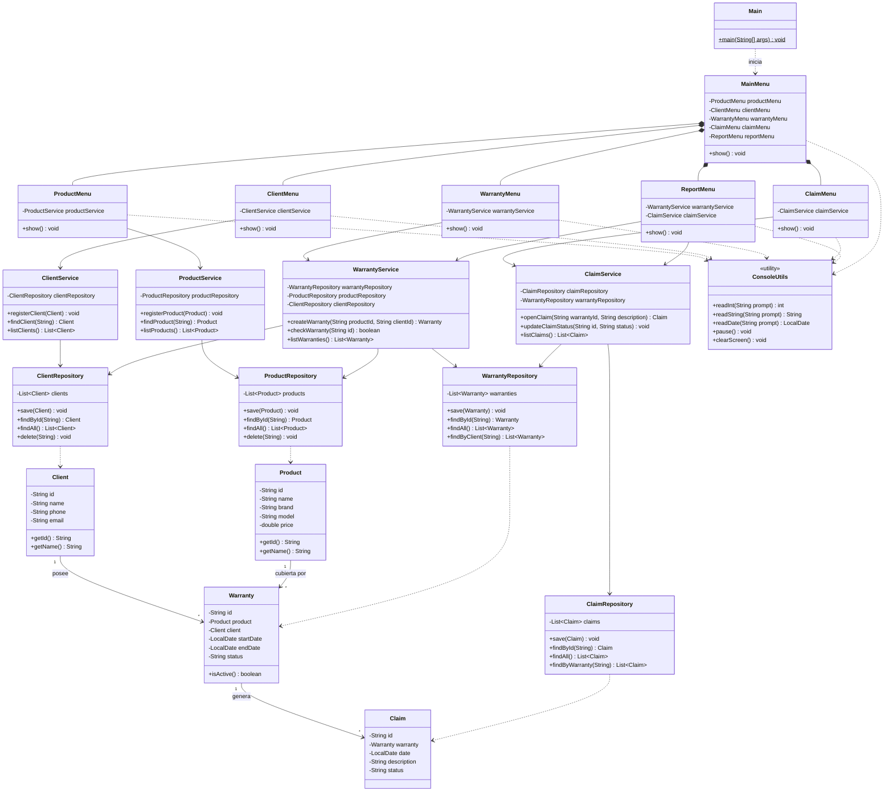

# Diagrama de clases — Sistema de garantías

Propuesta de diagrama de clases para el proyecto de Programación 3 (Java): sistema de seguimiento y control de garantías para tiendas de tecnología.

Los atributos y métodos son una propuesta; ajústalos a lo definido por el grupo.

## Notas de diseño

- **Capas:** Model → Repository → Service → UI, con `Main` como punto de entrada. Cada capa solo depende de la inmediatamente inferior, lo que permite cambiar el almacenamiento (memoria, archivos, base de datos) sin tocar los menús.
- **`WarrantyService` y `ClaimService`** dependen de varios repositorios porque validan la existencia de producto, cliente o garantía antes de crear el registro.
- **`ConsoleUtils`** concentra la lectura de datos por consola, de modo que los menús no repiten código de entrada.
