# SIGATEC: diagrama de clases general

Todas las clases del proyecto (56) en un solo diagrama, agrupadas por paquete, con las relaciones principales entre ellas.

> **Sin miembros.** Para que sea legible se muestran solo los nombres y estereotipos. Los atributos y métodos de cada capa están en `02` (modelo), `03` (repositorios), `04` (servicios) y `05` (interfaz).
>
> **Visualización.** Usa `namespace`, que requiere Mermaid 10.2 o superior (GitHub y las versiones recientes de los visores lo soportan). Con 131 relaciones conviene verlo en ancho completo o ampliado.

```mermaid
classDiagram
    direction TB

    namespace com.sigatec {
        class Main
        class Launcher
    }

    namespace com.sigatec.ui {
        class Screen {
            <<interface>>
        }
        class UiSupport {
            <<utility>>
        }
        class ConsoleUI
        class MainApp {
            <<JavaFX Application>>
        }
    }

    namespace com.sigatec.ui.view {
        class ProductsView
        class CustomersView
        class WarrantiesView
        class ClaimsView
        class ReportsView
        class DashboardView
    }

    namespace com.sigatec.service {
        class ProductFinder {
            <<interface>>
        }
        class CustomerFinder {
            <<interface>>
        }
        class WarrantyFinder {
            <<interface>>
        }
        class ProductService
        class CustomerService
        class WarrantyService
        class ClaimService
        class RemovalService
        class ReportService
    }

    namespace com.sigatec.repository {
        class Repository~T,K~ {
            <<interface>>
        }
        class ProductRepository {
            <<interface>>
        }
        class CustomerRepository {
            <<interface>>
        }
        class WarrantyRepository {
            <<interface>>
        }
        class ClaimRepository {
            <<interface>>
        }
        class SeedData {
            <<utility>>
        }
        class SequentialIdGenerator
        class PersistenceException
    }

    namespace com.sigatec.repository.memory {
        class InMemoryRepository~T,K~ {
            <<abstract>>
        }
        class InMemoryProductRepository
        class InMemoryCustomerRepository
        class InMemoryWarrantyRepository
        class InMemoryClaimRepository
    }

    namespace com.sigatec.repository.file {
        class FileStorage
        class FileProductRepository
        class FileCustomerRepository
        class FileWarrantyRepository
        class FileClaimRepository
        class TextFileStore {
            <<package-private>>
        }
        class RecordCodec {
            <<package-private>>
        }
    }

    namespace com.sigatec.repository.jdbc {
        class Database {
            <<final>>
        }
        class JdbcProductRepository
        class JdbcCustomerRepository
        class JdbcWarrantyRepository
        class JdbcClaimRepository
    }

    namespace com.sigatec.model {
        class Identifiable~K~ {
            <<interface>>
        }
        class Product
        class Customer
        class Warranty
        class Claim
        class StatusChange {
            <<record>>
        }
        class ClaimStatus {
            <<enumeration>>
        }
        class WarrantyStatus {
            <<enumeration>>
        }
        class Validations {
            <<utility>>
        }
        class DomainException
    }

    %% ---------------- model
    Identifiable <|.. Product
    Identifiable <|.. Customer
    Identifiable <|.. Warranty
    Identifiable <|.. Claim
    Warranty --> Product
    Warranty --> Customer
    Warranty ..> WarrantyStatus
    Claim --> Warranty
    Claim --> ClaimStatus
    Claim *-- StatusChange : historial
    StatusChange --> ClaimStatus
    Validations ..> DomainException

    %% ---------------- repository: contracts
    Repository ..> Identifiable : T extiende
    Repository <|-- ProductRepository
    Repository <|-- CustomerRepository
    Repository <|-- WarrantyRepository
    Repository <|-- ClaimRepository
    ProductRepository ..> Product
    CustomerRepository ..> Customer
    WarrantyRepository ..> Warranty
    ClaimRepository ..> Claim
    ClaimRepository ..> ClaimStatus
    SeedData ..> ProductRepository
    SeedData ..> CustomerRepository
    SeedData ..> WarrantyRepository
    SeedData ..> ClaimRepository

    %% ---------------- repository: memory
    Repository <|.. InMemoryRepository
    InMemoryRepository <|-- InMemoryProductRepository
    InMemoryRepository <|-- InMemoryCustomerRepository
    InMemoryRepository <|-- InMemoryWarrantyRepository
    InMemoryRepository <|-- InMemoryClaimRepository
    ProductRepository <|.. InMemoryProductRepository
    CustomerRepository <|.. InMemoryCustomerRepository
    WarrantyRepository <|.. InMemoryWarrantyRepository
    ClaimRepository <|.. InMemoryClaimRepository
    InMemoryWarrantyRepository --> SequentialIdGenerator
    InMemoryClaimRepository --> SequentialIdGenerator

    %% ---------------- repository: file
    InMemoryProductRepository <|-- FileProductRepository
    InMemoryCustomerRepository <|-- FileCustomerRepository
    InMemoryWarrantyRepository <|-- FileWarrantyRepository
    InMemoryClaimRepository <|-- FileClaimRepository
    FileProductRepository --> TextFileStore
    FileCustomerRepository --> TextFileStore
    FileWarrantyRepository --> TextFileStore
    FileClaimRepository --> TextFileStore
    TextFileStore --> RecordCodec
    TextFileStore ..> PersistenceException
    FileWarrantyRepository ..> ProductRepository : resuelve
    FileWarrantyRepository ..> CustomerRepository : resuelve
    FileClaimRepository ..> WarrantyRepository : resuelve
    FileStorage *-- FileProductRepository
    FileStorage *-- FileCustomerRepository
    FileStorage *-- FileWarrantyRepository
    FileStorage *-- FileClaimRepository
    FileStorage ..> SeedData : primera ejecución

    %% ---------------- repository: jdbc
    ProductRepository <|.. JdbcProductRepository
    CustomerRepository <|.. JdbcCustomerRepository
    WarrantyRepository <|.. JdbcWarrantyRepository
    ClaimRepository <|.. JdbcClaimRepository
    JdbcWarrantyRepository ..> ProductRepository : resuelve
    JdbcWarrantyRepository ..> CustomerRepository : resuelve
    JdbcClaimRepository ..> WarrantyRepository : resuelve
    JdbcProductRepository ..> Database : inferido
    JdbcCustomerRepository ..> Database : inferido
    JdbcWarrantyRepository ..> Database : inferido
    JdbcClaimRepository ..> Database : inferido
    Database ..> PersistenceException

    %% ---------------- service
    ProductFinder <|.. ProductService
    CustomerFinder <|.. CustomerService
    WarrantyFinder <|.. WarrantyService
    ProductFinder ..> Product
    CustomerFinder ..> Customer
    WarrantyFinder ..> Warranty
    ProductService --> ProductRepository
    CustomerService --> CustomerRepository
    WarrantyService --> WarrantyRepository
    ClaimService --> ClaimRepository
    WarrantyService --> ProductFinder
    WarrantyService --> CustomerFinder
    ClaimService --> WarrantyFinder
    RemovalService --> ProductService
    RemovalService --> CustomerService
    RemovalService --> WarrantyFinder
    ReportService --> WarrantyFinder
    ReportService --> ClaimService
    ClaimService ..> Claim
    ClaimService ..> ClaimStatus

    %% ---------------- ui
    Screen <|.. ProductsView
    Screen <|.. CustomersView
    Screen <|.. WarrantiesView
    Screen <|.. ClaimsView
    Screen <|.. ReportsView
    Screen <|.. DashboardView
    ProductsView ..> UiSupport
    CustomersView ..> UiSupport
    WarrantiesView ..> UiSupport
    ClaimsView ..> UiSupport
    ReportsView ..> UiSupport
    DashboardView ..> UiSupport
    ProductsView --> ProductService
    ProductsView --> RemovalService
    CustomersView --> CustomerService
    CustomersView --> RemovalService
    WarrantiesView --> WarrantyService
    ClaimsView --> ClaimService
    ReportsView --> ReportService
    DashboardView --> ReportService
    DashboardView --> ProductService
    ConsoleUI --> ProductService
    ConsoleUI --> CustomerService
    ConsoleUI --> WarrantyService
    ConsoleUI --> ClaimService

    %% ---------------- arranque
    Launcher ..> MainApp
    Main ..> ConsoleUI
    Main ..> FileStorage
    Main ..> ProductService
    Main ..> CustomerService
    Main ..> WarrantyService
    Main ..> ClaimService
    MainApp ..> Screen
    MainApp ..> ProductsView
    MainApp ..> CustomersView
    MainApp ..> WarrantiesView
    MainApp ..> ClaimsView
    MainApp ..> ReportsView
    MainApp ..> DashboardView
    MainApp ..> FileStorage
    MainApp ..> JdbcProductRepository
    MainApp ..> JdbcCustomerRepository
    MainApp ..> JdbcWarrantyRepository
    MainApp ..> JdbcClaimRepository
```

## Cómo leer las flechas

| Flecha | Significado |
|---|---|
| `A <\|-- B` | `B` hereda de `A` |
| `A <\|.. B` | `B` implementa la interfaz `A` |
| `A *-- B` | `A` está compuesta por `B` (`B` no existe sin `A`) |
| `A --> B` | `A` guarda una referencia a `B` en un atributo |
| `A ..> B` | `A` usa o depende de `B` |

## Clases por paquete

| Paquete | Clases |
|---|---|
| `com.sigatec` (2) | `Main`, `Launcher` |
| `ui` (4) | `Screen`, `UiSupport`, `ConsoleUI`, `MainApp` |
| `ui.view` (6) | `ProductsView`, `CustomersView`, `WarrantiesView`, `ClaimsView`, `ReportsView`, `DashboardView` |
| `service` (9) | `ProductFinder`, `CustomerFinder`, `WarrantyFinder`, `ProductService`, `CustomerService`, `WarrantyService`, `ClaimService`, `RemovalService`, `ReportService` |
| `repository` (8) | `Repository`, `ProductRepository`, `CustomerRepository`, `WarrantyRepository`, `ClaimRepository`, `SeedData`, `SequentialIdGenerator`, `PersistenceException` |
| `repository.memory` (5) | `InMemoryRepository`, `InMemoryProductRepository`, `InMemoryCustomerRepository`, `InMemoryWarrantyRepository`, `InMemoryClaimRepository` |
| `repository.file` (7) | `FileStorage`, `FileProductRepository`, `FileCustomerRepository`, `FileWarrantyRepository`, `FileClaimRepository`, `TextFileStore`, `RecordCodec` |
| `repository.jdbc` (5) | `Database`, `JdbcProductRepository`, `JdbcCustomerRepository`, `JdbcWarrantyRepository`, `JdbcClaimRepository` |
| `model` (10) | `Identifiable`, `Product`, `Customer`, `Warranty`, `Claim`, `StatusChange`, `ClaimStatus`, `WarrantyStatus`, `Validations`, `DomainException` |

## Qué se ve en el diagrama

- **Núcleo del dominio:** `Warranty` une `Product` y `Customer`; `Claim` apunta a una `Warranty` y contiene su historial de `StatusChange`. Las cuatro entidades implementan `Identifiable`.
- **Un contrato, tres implementaciones:** cada `*Repository` lo implementan una clase en memoria, una de archivo (que **extiende** a la de memoria) y una `Jdbc*` (que lo implementa directamente).
- **Los servicios solo ven interfaces:** reciben `*Repository` y `*Finder`, nunca `memory`, `file` ni `jdbc`. Las excepciones son `RemovalService` (usa `ProductService` y `CustomerService`) y `ReportService` (usa `ClaimService`).
- **Dos interfaces, dos arranques:** `Main` crea los servicios y arranca `ConsoleUI` con persistencia en archivos; `Launcher` lanza `MainApp`, que construye las seis pantallas.
- **Quién conoce las implementaciones:** `Main` (`FileStorage`) y `MainApp` (`FileStorage` y los cuatro `Jdbc*Repository`).

## Omitido a propósito

- `RuntimeException`, de la que heredan `DomainException` y `PersistenceException`.
- Las clases de JavaFX y del JDK usadas como tipos (`Parent`, `TableView`, `Scanner`, `Clock`, ...).
- `MainApp` también importa y crea los servicios (`service.*`), pero esas flechas se omiten para no saturar el diagrama.
- Las flechas de uso entre `PersistenceException` y los repositorios que la lanzan, salvo en `TextFileStore` y `Database`.