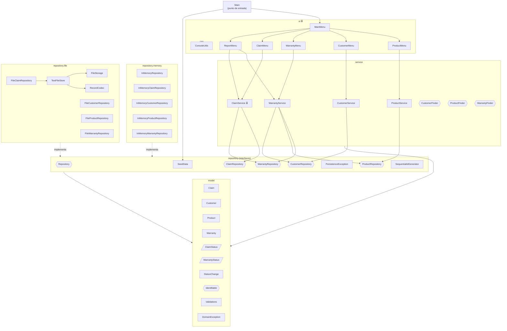
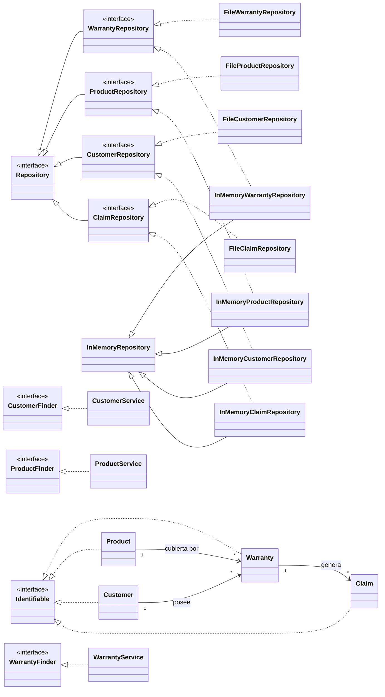

# Diagrama de jerarquía del sistema SIGATEC

Proyecto Java (Maven) con paquete base `com.sigatec`, organizado en capas: **model**, **repository**, **service** y **ui**.

Este documento combina dos fuentes:
- **Estructura real** del proyecto (capturas del IDE).
- **Diagrama de clases** del grupo (`class-diagram-SIGATEC.md`), usado para completar lo que aún no se ve en el código, principalmente el paquete `ui` y `ClaimService`.

**Leyenda:** 🟦 clase · 🟩 interfaz · 🟪 enum · 🟨 record · 🟧 excepción · ⏳ propuesto en el diagrama de clases, aún no confirmado en el código

---

## 1. Estructura de carpetas y archivos

```
SIGATEC-Project/
├── .idea/
├── .gitignore
├── pom.xml
├── README.md
├── SIGATEC-fase1.md
└── src/
    └── main/
        └── java/
            └── com.sigatec/
                ├── Main                                   🟦 punto de entrada
                │
                ├── model/                                 ── Capa de dominio
                │   ├── Claim                              🟦
                │   ├── ClaimStatus                        🟪
                │   ├── Customer                           🟦 (Client en el diagrama de clases)
                │   ├── DomainException                    🟧
                │   ├── Identifiable                       🟩
                │   ├── Product                            🟦
                │   ├── StatusChange                       🟨 (record)
                │   ├── Validations                        🟦
                │   ├── Warranty                           🟦
                │   └── WarrantyStatus                     🟪
                │
                ├── repository/                            ── Capa de persistencia
                │   ├── Repository                         🟩 contrato genérico
                │   ├── ClaimRepository                    🟩
                │   ├── CustomerRepository                 🟩
                │   ├── ProductRepository                  🟩
                │   ├── WarrantyRepository                 🟩
                │   ├── PersistenceException               🟧
                │   ├── SeedData                           🟦 datos iniciales
                │   ├── SequentialIdGenerator              🟦 generador de IDs
                │   │
                │   ├── file/                              ── Implementación en archivos
                │   │   ├── FileClaimRepository            🟦
                │   │   ├── FileCustomerRepository         🟦
                │   │   ├── FileProductRepository          🟦
                │   │   ├── FileWarrantyRepository         🟦
                │   │   ├── FileStorage                    🟦
                │   │   ├── RecordCodec                    🟦
                │   │   └── TextFileStore                  🟦
                │   │
                │   └── memory/                            ── Implementación en memoria
                │       ├── InMemoryRepository             🟦 base común
                │       ├── InMemoryClaimRepository        🟦
                │       ├── InMemoryCustomerRepository     🟦
                │       ├── InMemoryProductRepository      🟦
                │       └── InMemoryWarrantyRepository     🟦
                │
                ├── service/                               ── Capa de lógica de negocio
                │   ├── CustomerFinder                     🟩
                │   ├── CustomerService                    🟦 (ClientService en el diagrama de clases)
                │   ├── ProductFinder                      🟩
                │   ├── ProductService                     🟦
                │   ├── WarrantyFinder                     🟩
                │   ├── WarrantyService                    🟦
                │   └── ClaimService                       ⏳ (no aparece en las capturas)
                │
                └── ui/                                    ── Capa de interfaz (según diagrama de clases)
                    ├── ConsoleUtils                       ⏳ 🟦 utilidad de lectura por consola
                    ├── MainMenu                           ⏳ 🟦 menú principal
                    ├── ProductMenu                        ⏳ 🟦
                    ├── CustomerMenu                       ⏳ 🟦 (ClientMenu en el diagrama de clases)
                    ├── WarrantyMenu                       ⏳ 🟦
                    ├── ClaimMenu                          ⏳ 🟦
                    └── ReportMenu                         ⏳ 🟦
```

---

## 2. Diagrama de capas y dependencias



---

## 3. Jerarquía de herencia / implementación



---

## 4. Resumen por capa

| Capa | Paquete | Responsabilidad | Elementos |
|------|---------|-----------------|-----------|
| Entrada | `com.sigatec` | Arranque de la aplicación | `Main` |
| Dominio | `model` | Entidades, estados, validaciones y errores de dominio | 10 tipos |
| Persistencia (contratos) | `repository` | Interfaces de repositorio, IDs, datos semilla | 8 tipos |
| Persistencia (archivos) | `repository.file` | Almacenamiento en archivos de texto | 7 clases |
| Persistencia (memoria) | `repository.memory` | Almacenamiento en memoria | 5 clases |
| Negocio | `service` | Servicios y buscadores por entidad | 6 tipos confirmados + `ClaimService` ⏳ |
| Presentación | `ui` | Menús de consola y utilidades | 7 clases ⏳ |

---

## 5. Concordancia con el diagrama de clases

| Aspecto | Diagrama de clases | Proyecto real | Tratamiento aquí |
|---------|--------------------|---------------|------------------|
| Nombre de la entidad cliente | `Client`, `ClientRepository`, `ClientService`, `ClientMenu` | `Customer`, `CustomerRepository`, `CustomerService` | Se usa `Customer`; se anota la equivalencia |
| Repositorios | Clases concretas con una `List` interna | Interfaces con implementaciones `memory` y `file` | Se mantiene la estructura real |
| Servicios | `ProductService`, `ClientService`, `WarrantyService`, `ClaimService` | Falta `ClaimService` en las capturas | Se agrega `ClaimService` ⏳ |
| Interfaces `*Finder` | No existen | `CustomerFinder`, `ProductFinder`, `WarrantyFinder` | Se mantienen (solo en el real) |
| Paquete `ui` | `MainMenu`, 5 menús y `ConsoleUtils` | No visible (colapsado) | Se incorpora como ⏳ |
| Clases de apoyo del modelo | No aparecen | `Identifiable`, `Validations`, `StatusChange`, `DomainException`, `ClaimStatus`, `WarrantyStatus` | Se mantienen (solo en el real) |
| Persistencia | No aparece | `SeedData`, `SequentialIdGenerator`, `PersistenceException`, clases de `file` | Se mantienen (solo en el real) |
| Estado como texto | `status` es `String` | Enums `ClaimStatus` y `WarrantyStatus` | Se mantiene el enum real |
| Relaciones del modelo | Cliente → Garantía, Producto → Garantía, Garantía → Reclamo | Coinciden con los nombres de las clases | Se agregan al diagrama 3 |
| Capas | Model → Repository → Service → UI | Igual | Coinciden |

**Conclusión:** la arquitectura por capas y las relaciones del dominio coinciden. Las diferencias son de nombre (`Client` / `Customer`) y de nivel de detalle: el diagrama de clases es una propuesta más simple y el proyecto real ya agrega interfaces, doble persistencia y clases de apoyo.

---

## 6. Pendientes por verificar

- Confirmar si existen `ClaimService` y los menús de `ui` en el código, o si siguen en desarrollo.
- Decidir un solo nombre (`Client` o `Customer`) y actualizar el diagrama de clases para que coincida con el código.
- Las relaciones de los diagramas 2 y 3 se deducen de los nombres y del diagrama de clases; conviene validarlas contra el código.
