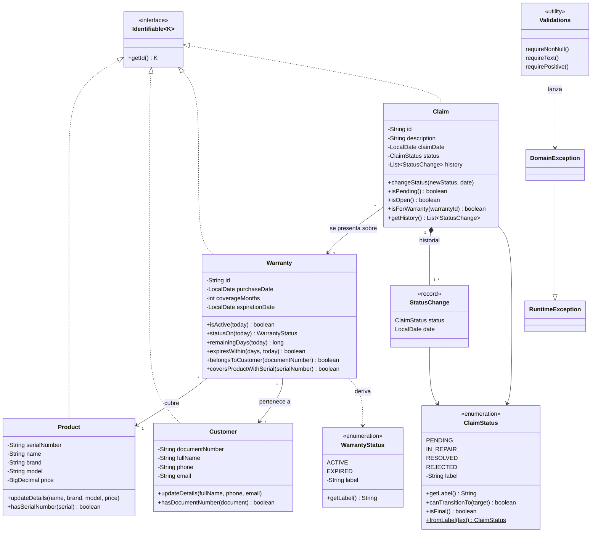

# SIGATEC: diagrama de clases del modelo (`com.sigatec.model`)

Se omiten por brevedad los getters, `equals`, `hashCode` y `toString`.

## Clases

| Clase | Responsabilidad |
|---|---|
| `Identifiable<K>` | Contrato de toda entidad con identidad (`getId()`); permite repositorios genéricos. |
| `Product` | Producto individual. Identidad: número de serie (inmutable, en mayúsculas). Se modifica con `updateDetails`, de forma atómica. |
| `Customer` | Cliente. Identidad: documento. Limpia el teléfono y valida el email; se modifica con `updateDetails`. |
| `Warranty` | Une un producto con un cliente, una fecha de compra y meses de cobertura. Inmutable; calcula su vencimiento y su vigencia. |
| `Claim` | Reclamación sobre una garantía. Tiene dos constructores (estado inicial `PENDING` o el indicado). Cambia de estado solo con `changeStatus`, que valida la transición y registra el historial. |
| `StatusChange` | Registro inmutable (`record`) de un cambio de estado: estado y fecha. |
| `ClaimStatus` | Estados de una reclamación y transiciones permitidas. Convierte el texto del usuario en estado (`fromLabel`). |
| `WarrantyStatus` | Vigencia de una garantía en una fecha: `ACTIVE` o `EXPIRED`. Valor derivado, no se guarda. |
| `Validations` | Utilidad interna del paquete con las comprobaciones repetidas (DRY). |
| `DomainException` | Excepción no verificada para reglas de negocio violadas. |

## Relaciones
- `Warranty` apunta a un `Product` y a un `Customer`.
- `Claim` apunta a una `Warranty` y **contiene** su historial: una o más instancias de `StatusChange` (composición).
- `Warranty` deriva un `WarrantyStatus` a partir de la fecha de referencia que recibe; nunca lo almacena.

## Reglas de dominio que protege
- Una garantía está vigente hasta el día de vencimiento **inclusive**.
- Transiciones de `ClaimStatus`: `PENDING` → `IN_REPAIR`, `RESOLVED` o `REJECTED`; `IN_REPAIR` → `RESOLVED` o `REJECTED`; `RESOLVED` y `REJECTED` son finales.
- Una reclamación no puede ser anterior a la fecha de compra de su garantía, y un cambio de estado no puede tener fecha anterior al último.
- Los métodos que dependen del tiempo reciben la fecha como parámetro; el modelo nunca consulta el reloj del sistema.
