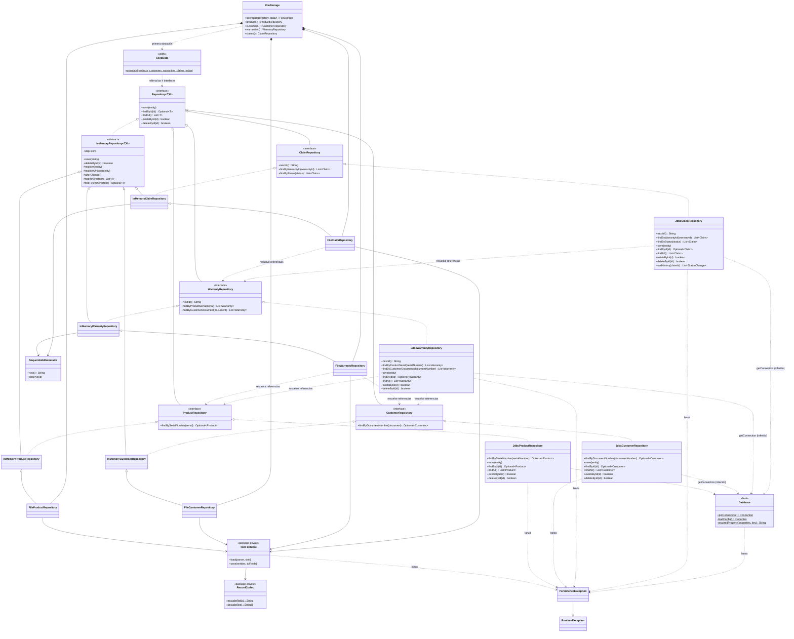

# SIGATEC: diagrama de clases de los repositorios (`com.sigatec.repository`)

Incluye los contratos, la base en memoria, la persistencia en archivos y la persistencia SQL.

## Clases

**Contratos (`repository`)**

| Clase | Responsabilidad |
|---|---|
| `Repository<T,K>` | Contrato genérico: guardar (inserta o reemplaza), buscar por id, listar, existencia y borrado. |
| `ProductRepository`, `CustomerRepository` | Agregan la búsqueda por serie y por documento. |
| `WarrantyRepository`, `ClaimRepository` | Agregan `nextId()` y sus búsquedas (garantías por serie o cliente; reclamaciones por garantía o estado). |
| `SequentialIdGenerator` | Genera ids legibles (`GAR-0001`) y continúa la secuencia después del mayor id existente. |
| `PersistenceException` | Error de lectura o escritura de datos. |
| `SeedData` | Datos de prueba con fechas relativas a «hoy». Trabaja contra las interfaces, así que rellena cualquier implementación. |

**En memoria (`repository.memory`)**

| Clase | Responsabilidad |
|---|---|
| `InMemoryRepository<T,K>` | CRUD escrito una sola vez sobre un mapa que conserva el orden. Gancho `afterChange()` con deshacer si falla. |
| `InMemory{Product,Customer,Warranty,Claim}Repository` | Agregan solo su búsqueda específica. Los de garantía y reclamación también generan ids. |

**En archivos (`repository.file`)**

| Clase | Responsabilidad |
|---|---|
| `FileStorage` | Abre los cuatro repositorios en el orden correcto y siembra los datos de prueba solo en la primera ejecución. |
| `File{Product,Customer,Warranty,Claim}Repository` | Extienden los de memoria: cargan su `.txt` al iniciar y lo reescriben tras cada cambio. Garantías y reclamaciones guardan solo las claves de lo que referencian y las resuelven al cargar. |
| `TextFileStore` | Única clase que toca archivos: lee y escribe en UTF-8 usando un archivo temporal. |
| `RecordCodec` | Convierte un registro en una línea con campos separados por `|`, escapando caracteres especiales. |

**Base de datos (`repository.jdbc`)**

| Clase | Responsabilidad |
|---|---|
| `Database` | Entrega la conexión (`getConnection()`); la configuración se lee en un `Properties` y valida que cada propiedad obligatoria exista. |
| `Jdbc{Product,Customer,Warranty,Claim}Repository` | Implementan los contratos con consultas SQL, **sin** heredar de memoria. `JdbcWarrantyRepository` y `JdbcClaimRepository` resuelven sus referencias a través de otros repositorios; `JdbcClaimRepository` carga además el historial de estados. |

## Decisiones de diseño
- **Inversión de dependencias:** los servicios dependen de los contratos; la implementación es intercambiable (memoria, archivos o SQL).
- **Reutilización en archivos:** `file` hereda de `memory` y solo agrega leer y escribir.
- **SQL independiente:** `jdbc` implementa las interfaces directamente porque su almacenamiento no es un mapa en memoria.
- **Consistencia:** si guardar en disco falla, el cambio en memoria se deshace y se lanza `PersistenceException`.
- **Integridad al cargar (archivos):** un archivo dañado hace fallar el inicio con el nombre del archivo y la línea.
