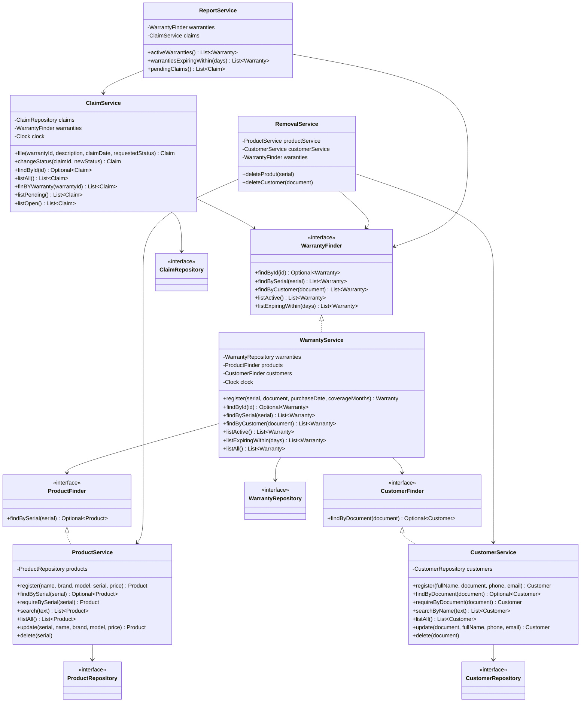

# SIGATEC: diagrama de clases de los servicios (`com.sigatec.service`)

Se omiten los métodos privados y las clases del modelo y de `repository` que solo se usan como tipos (se muestran las cuatro interfaces de repositorio que los servicios guardan en un atributo).

## Clases

| Clase | Responsabilidad |
|---|---|
| `ProductService` | Casos de uso de productos: registrar, buscar (`findBySerial` devuelve `Optional`; `requireBySerial` falla si no existe), buscar por texto, listar, modificar y eliminar. Implementa `ProductFinder`. |
| `CustomerService` | Lo mismo para clientes, con búsqueda por nombre. Implementa `CustomerFinder`. |
| `WarrantyService` | Registrar garantías (consulta producto y cliente a través de sus `*Finder`) y listar o buscar por id, serie, cliente, vigencia o vencimiento próximo. Usa `Clock`. Implementa `WarrantyFinder`. |
| `ClaimService` | Presentar una reclamación sobre una garantía (`file`), cambiar su estado, buscarla y listarla (todas, pendientes, abiertas, por garantía). Usa `Clock`. |
| `RemovalService` | Eliminar productos y clientes. *Por su dependencia de `WarrantyFinder`, presumiblemente comprueba que no tengan garantías antes de borrar.* |
| `ReportService` | Garantías activas, garantías por vencer en N días y reclamaciones pendientes (estas últimas a través de `ClaimService`). |
| `ProductFinder`, `CustomerFinder`, `WarrantyFinder` | Interfaces de consulta de solo lectura: permiten que un servicio busque una entidad sin depender de la clase concreta de otro. |

## Relaciones
- Cada servicio de entidad implementa su `*Finder`.
- `WarrantyService` consulta productos y clientes por interfaz; `ClaimService`, `RemovalService` y `ReportService` consultan garantías por interfaz.
- Todos usan las entidades y `DomainException` del modelo (los servicios de producto, cliente, garantía, reclamación y eliminación importan esa excepción).
