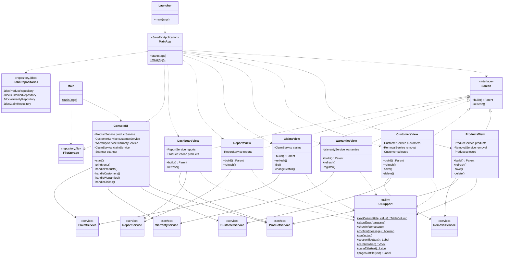

# SIGATEC: diagrama de clases de la interfaz (`com.sigatec.ui`)

Hay **dos interfaces** sobre los mismos servicios: la de consola (`ConsoleUI`, arrancada por `Main`) y la gráfica JavaFX (`MainApp` y seis pantallas, arrancada por `Launcher`). Se omiten los campos de componentes gráficos (`TextField`, `Button`, `TableView`, ...) y los métodos privados auxiliares.

## Clases

| Clase | Paquete | Responsabilidad |
|---|---|---|
| `Screen` | `ui` | Contrato de una pantalla: `build()` crea su contenido y `refresh()` lo actualiza. |
| `UiSupport` | `ui` | Ayudantes estáticos compartidos por las pantallas: columnas de tabla, diálogos de error, información y confirmación, ejecución protegida de acciones, títulos y tarjetas. |
| `ProductsView`, `CustomersView` | `ui.view` | Formulario, búsqueda y tabla; reciben `RemovalService`, presumiblemente para eliminar con su regla de integridad. |
| `WarrantiesView` | `ui.view` | Registrar garantías y filtrarlas (todas, vigentes, vencidas). |
| `ClaimsView` | `ui.view` | Presentar reclamaciones, filtrar por estado y cambiarlo. |
| `ReportsView` | `ui.view` | Garantías activas, garantías por vencer (días configurables) y reclamaciones pendientes. |
| `DashboardView` | `ui.view` | Panel con indicadores (garantías activas, por vencer, reclamaciones pendientes y total de productos) y una tabla de garantías por vencer en 30 días, según los nombres de sus campos. |
| `ConsoleUI` | `ui` | Interfaz de consola con menús para productos, clientes, garantías y reclamaciones. |
| `MainApp` | `ui` | Aplicación JavaFX: construye las dependencias, las pantallas y la navegación entre ellas. |
| `Launcher` | `com.sigatec` | Punto de entrada que lanza `MainApp`. |
| `Main` | `com.sigatec` | Punto de entrada de la consola: abre `FileStorage`, crea los servicios y arranca `ConsoleUI`. |

## Relaciones
- Las seis pantallas implementan `Screen` y usan `UiSupport`.
- `ProductsView` y `CustomersView` reciben `RemovalService` además de su servicio.
- `ReportsView` y `DashboardView` usan `ReportService`; `DashboardView` agrega `ProductService` para el total de productos.
- `ConsoleUI` **no** usa `Screen`, `ReportService` ni `RemovalService`.
- `MainApp` importa `FileStorage` y los cuatro `Jdbc*Repository`: el origen de la persistencia se decide dentro del paquete `ui`.