# SIGATEC: diagrama de jerarquía de clases

Muestra únicamente la herencia (`extends`) y la implementación de interfaces (`implements`) entre las clases del proyecto. Para las demás relaciones (uso, composición) ver `06-diagrama-de-clases-general.md`.


| Flecha | Significado |
|---|---|
| `A <\|-- B` | `B` hereda de `A` (también entre interfaces) |
| `A <\|.. B` | `B` implementa la interfaz `A` |

Los tipos marcados `java.lang` y `javafx` son externos al proyecto. `Enum` y `Record` son las superclases implícitas de un `enum` y de un `record`.

```mermaid
classDiagram
    direction TB

    %% ---------- tipos externos (JDK / JavaFX)
    class RuntimeException {
        <<java.lang>>
    }
    class Enum {
        <<java.lang>>
    }
    class Record {
        <<java.lang>>
    }
    class Application {
        <<javafx>>
    }

    %% ---------- interfaces y abstractas
    class Identifiable~K~ {
        <<interface>>
    }
    class Repository~T,K~ {
        <<interface>>
    }
    class ProductRepository {
        <<interface>>
    }
    class CustomerRepository {
        <<interface>>
    }
    class WarrantyRepository {
        <<interface>>
    }
    class ClaimRepository {
        <<interface>>
    }
    class InMemoryRepository~T,K~ {
        <<abstract>>
    }
    class ProductFinder {
        <<interface>>
    }
    class CustomerFinder {
        <<interface>>
    }
    class WarrantyFinder {
        <<interface>>
    }
    class Screen {
        <<interface>>
    }

    %% ---------- dominio
    Identifiable <|.. Product
    Identifiable <|.. Customer
    Identifiable <|.. Warranty
    Identifiable <|.. Claim
    Enum <|-- ClaimStatus
    Enum <|-- WarrantyStatus
    Record <|-- StatusChange

    %% ---------- excepciones
    RuntimeException <|-- DomainException
    RuntimeException <|-- PersistenceException

    %% ---------- repositorios: contratos
    Repository <|-- ProductRepository
    Repository <|-- CustomerRepository
    Repository <|-- WarrantyRepository
    Repository <|-- ClaimRepository

    %% ---------- repositorios: memoria y archivos
    Repository <|.. InMemoryRepository
    InMemoryRepository <|-- InMemoryProductRepository
    InMemoryRepository <|-- InMemoryCustomerRepository
    InMemoryRepository <|-- InMemoryWarrantyRepository
    InMemoryRepository <|-- InMemoryClaimRepository
    ProductRepository <|.. InMemoryProductRepository
    CustomerRepository <|.. InMemoryCustomerRepository
    WarrantyRepository <|.. InMemoryWarrantyRepository
    ClaimRepository <|.. InMemoryClaimRepository
    InMemoryProductRepository <|-- FileProductRepository
    InMemoryCustomerRepository <|-- FileCustomerRepository
    InMemoryWarrantyRepository <|-- FileWarrantyRepository
    InMemoryClaimRepository <|-- FileClaimRepository

    %% ---------- repositorios: SQL (implementan directamente)
    ProductRepository <|.. JdbcProductRepository
    CustomerRepository <|.. JdbcCustomerRepository
    WarrantyRepository <|.. JdbcWarrantyRepository
    ClaimRepository <|.. JdbcClaimRepository

    %% ---------- servicios
    ProductFinder <|.. ProductService
    CustomerFinder <|.. CustomerService
    WarrantyFinder <|.. WarrantyService

    %% ---------- interfaz
    Screen <|.. ProductsView
    Screen <|.. CustomersView
    Screen <|.. WarrantiesView
    Screen <|.. ClaimsView
    Screen <|.. ReportsView
    Screen <|.. DashboardView
    Application <|-- MainApp
```



## Jerarquía en forma de árbol

```
Identifiable<K>  «interfaz»
├── Product
├── Customer
├── Warranty
└── Claim

Repository<T,K>  «interfaz»
├── ProductRepository  «interfaz»
│   ├── JdbcProductRepository
│   └── InMemoryProductRepository   (además extiende InMemoryRepository)
│       └── FileProductRepository
├── CustomerRepository  «interfaz»
│   ├── JdbcCustomerRepository
│   └── InMemoryCustomerRepository  (además extiende InMemoryRepository)
│       └── FileCustomerRepository
├── WarrantyRepository  «interfaz»
│   ├── JdbcWarrantyRepository
│   └── InMemoryWarrantyRepository  (además extiende InMemoryRepository)
│       └── FileWarrantyRepository
├── ClaimRepository  «interfaz»
│   ├── JdbcClaimRepository
│   └── InMemoryClaimRepository     (además extiende InMemoryRepository)
│       └── FileClaimRepository
└── InMemoryRepository<T,K>  «abstracta»
    ├── InMemoryProductRepository   (ver arriba)
    ├── InMemoryCustomerRepository
    ├── InMemoryWarrantyRepository
    └── InMemoryClaimRepository

ProductFinder   «interfaz»  └── ProductService
CustomerFinder  «interfaz»  └── CustomerService
WarrantyFinder  «interfaz»  └── WarrantyService

Screen  «interfaz»
├── ProductsView
├── CustomersView
├── WarrantiesView
├── ClaimsView
├── ReportsView
└── DashboardView

RuntimeException (java.lang)
├── DomainException
└── PersistenceException

Application (javafx)
└── MainApp

Enum (java.lang)  ├── ClaimStatus  └── WarrantyStatus
Record (java.lang)  └── StatusChange
```

## Tabla de jerarquía

| Superclase o interfaz | Tipo | Subclases o implementaciones |
|---|---|---|
| `Identifiable<K>` | interfaz | `Product`, `Customer`, `Warranty`, `Claim` |
| `Repository<T,K>` | interfaz | `ProductRepository`, `CustomerRepository`, `WarrantyRepository`, `ClaimRepository` (interfaces); `InMemoryRepository` (clase) |
| `ProductRepository` | interfaz | `InMemoryProductRepository`, `JdbcProductRepository` |
| `CustomerRepository` | interfaz | `InMemoryCustomerRepository`, `JdbcCustomerRepository` |
| `WarrantyRepository` | interfaz | `InMemoryWarrantyRepository`, `JdbcWarrantyRepository` |
| `ClaimRepository` | interfaz | `InMemoryClaimRepository`, `JdbcClaimRepository` |
| `InMemoryRepository<T,K>` | clase abstracta | `InMemoryProductRepository`, `InMemoryCustomerRepository`, `InMemoryWarrantyRepository`, `InMemoryClaimRepository` |
| `InMemoryProductRepository` | clase | `FileProductRepository` |
| `InMemoryCustomerRepository` | clase | `FileCustomerRepository` |
| `InMemoryWarrantyRepository` | clase | `FileWarrantyRepository` |
| `InMemoryClaimRepository` | clase | `FileClaimRepository` |
| `ProductFinder` | interfaz | `ProductService` |
| `CustomerFinder` | interfaz | `CustomerService` |
| `WarrantyFinder` | interfaz | `WarrantyService` |
| `Screen` | interfaz | `ProductsView`, `CustomersView`, `WarrantiesView`, `ClaimsView`, `ReportsView`, `DashboardView` |
| `RuntimeException` | externa | `DomainException`, `PersistenceException` |
| `Application` | externa (JavaFX) | `MainApp` |
| `Enum` | implícita | `ClaimStatus`, `WarrantyStatus` |
| `Record` | implícita | `StatusChange` |

## Qué se observa

- **La jerarquía más profunda es la de repositorios**: `Repository` → `InMemoryRepository` → `InMemoryProductRepository` → `FileProductRepository` (4 niveles). Cada `InMemory*` hereda el CRUD de la base abstracta **y** además implementa el contrato de su entidad.
- **Los repositorios `Jdbc*` no heredan de ninguna clase del proyecto**: implementan el contrato directamente, a un solo nivel.
- **Todo lo demás es plano**: los servicios, las pantallas y las entidades tienen un único nivel de herencia (o ninguno).
- **Herencia solo donde reutiliza código**: `file` extiende `memory` porque necesita su CRUD; las interfaces (`Repository`, `*Finder`, `Screen`, `Identifiable`) se usan para desacoplar.

## Clases sin herencia propia (14)

No extienden ni implementan nada del proyecto, así que no aparecen en el diagrama.

| Paquete | Clases |
|---|---|
| `model` | `Validations` |
| `repository` | `SeedData`, `SequentialIdGenerator` |
| `repository.file` | `FileStorage`, `TextFileStore`, `RecordCodec` |
| `repository.jdbc` | `Database` |
| `service` | `ClaimService`, `RemovalService`, `ReportService` |
| `ui` | `ConsoleUI`, `UiSupport` |
| `com.sigatec` | `Main`, `Launcher` |

Total: 42 clases en la jerarquía + 14 sin herencia propia = **56 clases**.