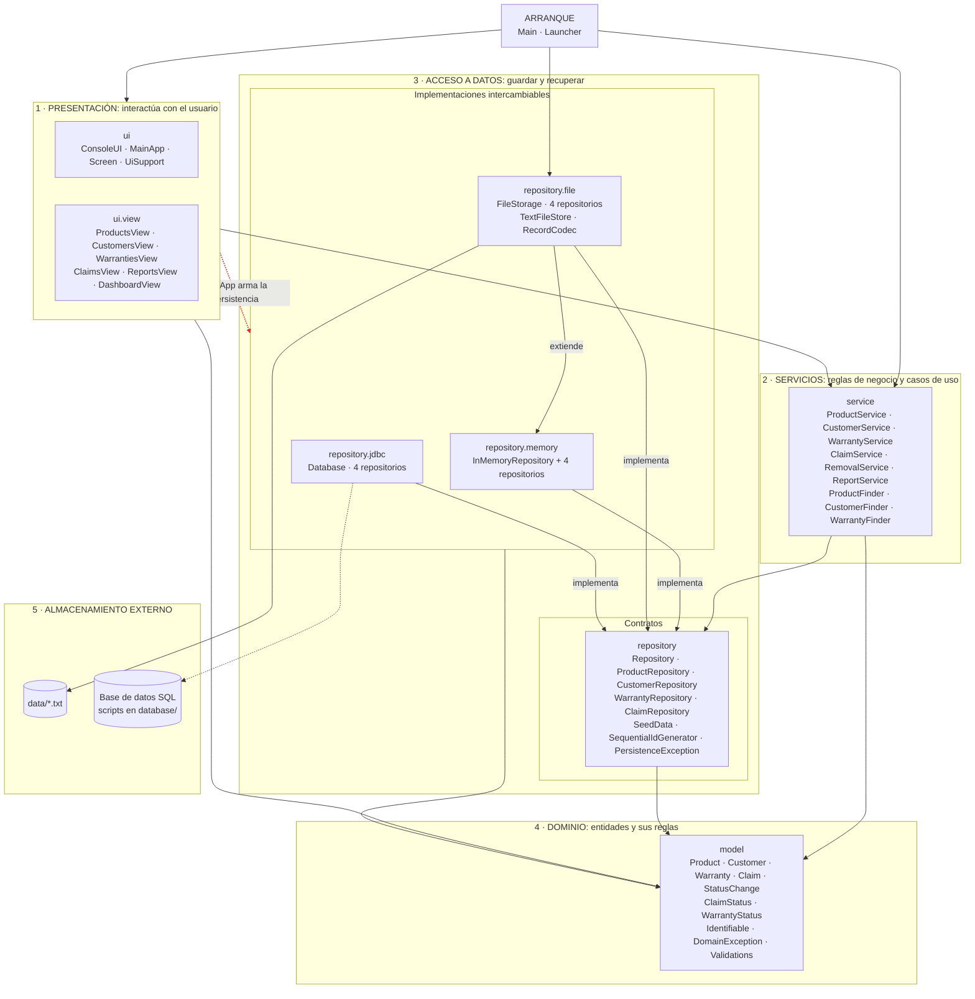

# SIGATEC: diagrama de capas

Muestra las capas de la arquitectura, qué clases hay en cada una y quién puede depender de quién. Las flechas significan «depende de».

## Capas y su responsabilidad

| # | Capa | Paquetes | Clases | Responsabilidad | Puede depender de | No debe |
|---|---|---|---|---|---|---|
| 1 | **Presentación** | `ui`, `ui.view` | 10 | Mostrar menús y pantallas (consola y JavaFX), leer lo que escribe el usuario y mostrar resultados y errores. | Servicios, dominio | Contener reglas de negocio ni tocar repositorios |
| 2 | **Servicios** | `service` | 9 | Casos de uso y reglas que involucran varias entidades: evitar duplicados, validar referencias, cambiar estados, eliminar sin romper relaciones, reportes. | Contratos de repositorio, dominio | Conocer la interfaz ni cómo se guardan los datos |
| 3a | **Acceso a datos: contratos** | `repository` | 8 | Definir **qué** se guarda y busca (`Repository<T,K>` y una interfaz por entidad), más ids, errores y datos de prueba. | Dominio | Reglas de negocio |
| 3b | **Acceso a datos: implementaciones** | `repository.memory`, `.file`, `.jdbc` | 17 | Definir **cómo** se guarda: memoria, archivos de texto o SQL. Son intercambiables. | Contratos, dominio, almacenamiento | Decidir reglas de negocio |
| 4 | **Dominio** | `model` | 10 | Entidades y sus invariantes: datos válidos, vigencia, transiciones de estado. | Nada | Depender de cualquier otra capa |
| 5 | **Almacenamiento externo** | `data/`, `database/` | n/a | Archivos `.txt` y base de datos SQL. | n/a | n/a |
| n/a | **Arranque** | `com.sigatec` | 2 | Crear los objetos concretos y conectarlos (`Main` para consola, `Launcher` para JavaFX). | Todas | Lógica de negocio |

Total: 10 + 9 + 8 + 17 + 10 + 2 = **56 clases**.

## Regla de dependencia
Cada capa solo conoce a las de abajo; el dominio no conoce a ninguna. Las implementaciones de persistencia dependen de los **contratos** (inversión de dependencias), por eso se puede cambiar de memoria a archivos o a SQL sin tocar los servicios. Verificado con los `import`: `service` importa únicamente interfaces de `repository`, y `model` no importa ningún otro paquete.
