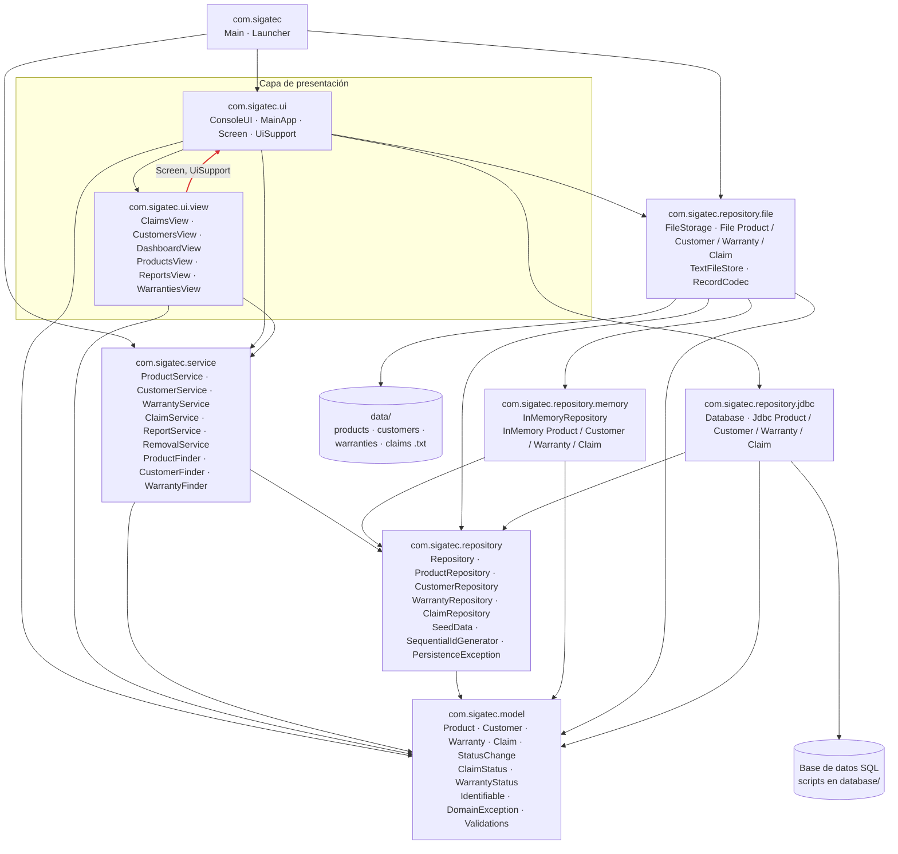

# SIGATEC: diagrama de paquetes

Muestra los paquetes del proyecto y de quién depende cada uno. Las flechas significan «depende de».

## Dependencias entre paquetes

| Origen | Destino | Evidencia |
|---|---|---|
| `com.sigatec` | `ui` | `Main` importa `ConsoleUI`; `Launcher` importa `MainApp` |
| `com.sigatec` | `service` | `Main` importa los servicios de producto, cliente, garantía y reclamación |
| `com.sigatec` | `repository.file` | `Main` importa `FileStorage` |
| `ui` | `ui.view` | `MainApp` importa `ui.view.*` |
| `ui.view` | `ui` | Las seis vistas importan `Screen` y `UiSupport` (**circular**) |
| `ui`, `ui.view` | `service` | `ConsoleUI`, `MainApp` y las vistas importan servicios |
| `ui` | `repository.file`, `repository.jdbc` | `MainApp` importa `FileStorage` y los cuatro `Jdbc*Repository` |
| `ui`, `ui.view` | `model` | Muestran entidades (`Claim`, `Product`, ...) y capturan `DomainException` |
| `service` | `repository` | Importan solo las **interfaces** de repositorio |
| `service` | `model` | Usan las entidades y `DomainException` |
| `repository` | `model` | Los contratos hablan en términos de entidades |
| `repository.memory` | `repository`, `model` | Implementa los contratos |
| `repository.file` | `repository.memory` | Extiende los repositorios en memoria |
| `repository.file` | `repository`, `model` | Implementa contratos y usa `PersistenceException` |
| `repository.jdbc` | `repository`, `model` | Implementa los contratos con entidades |
| `repository.file` | `data/*.txt` | Lee y escribe los archivos de datos |
| `repository.jdbc` | base de datos SQL | **Inferida:** `Database.getConnection()` y los scripts de `../database` |

## Cómo leerlo
- Todo converge en `model`, que no depende de ningún otro paquete.
- `service` solo ve los **contratos** de `repository`; nunca `memory`, `file` ni `jdbc`.
- `repository.jdbc` **no** pasa por `memory`: implementa las interfaces directamente.
- Hay dos arranques: `Main` (consola, con persistencia en texto) y `Launcher` → `MainApp` (JavaFX). `MainApp` arma sus propias dependencias, por eso `ui` apunta a `repository.file` y `repository.jdbc`.
- Los recursos de la interfaz gráfica (`app.css`, `icon.png`) están en `resources/com/sigatec/ui`.